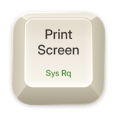
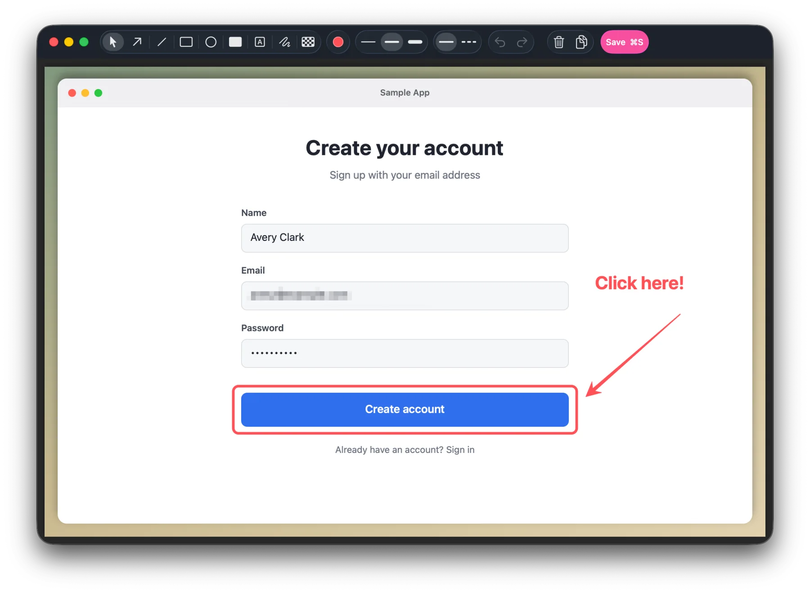
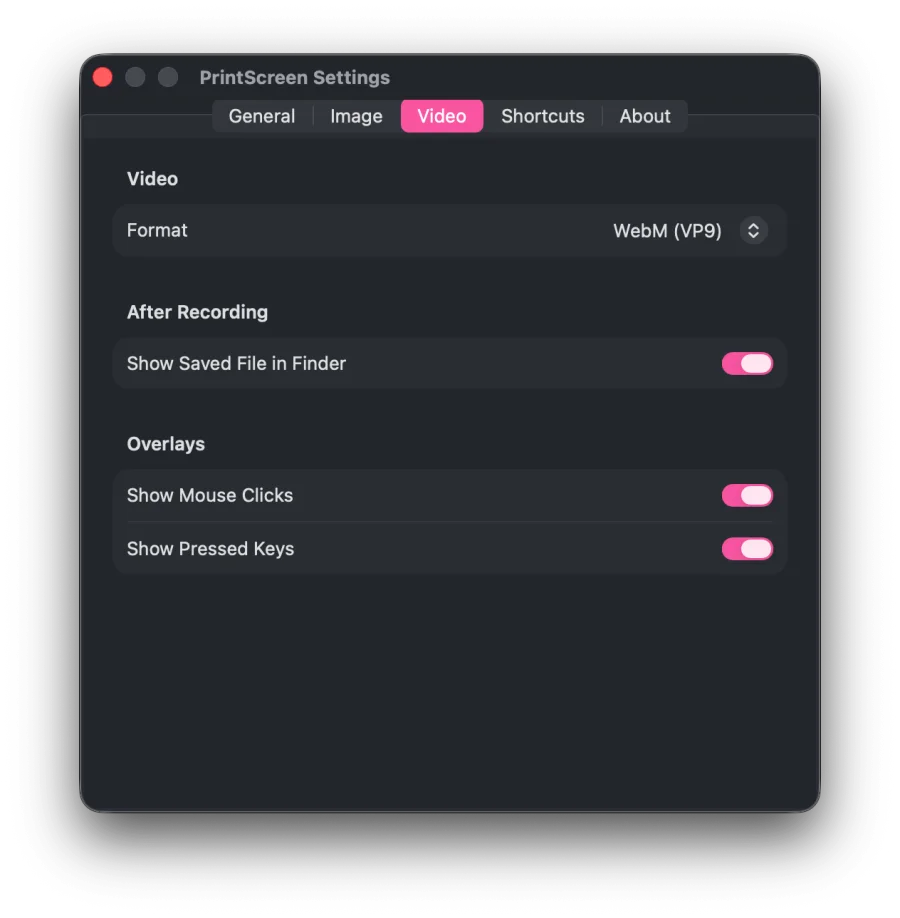

<p align="center">
  
</p>

# PrintScreen

A menu bar screenshot and screen recording app for macOS. Capture, annotate right away, and save as WebP or WebM.

[printscreen.morishin.me](https://printscreen.morishin.me)

https://github.com/user-attachments/assets/7cddf61a-dd6d-4e95-b5dd-469156826ebf

## Features

- **Annotate after capture** — arrows, lines, rectangles, ellipses, filled boxes, text, pen, and mosaic, with undo and redo
- **Modern formats** — save images as WebP, PNG, or JPEG, and videos as WebM, MP4, or MOV
- **Full screen, area, or window** — press Space during area selection to pick a window, with its shadow
- **Screen recording overlays** — show mouse clicks as ripples, and optionally show pressed keys
- **Custom shortcuts** — change, add, or remove global shortcuts, including the Print Screen key
- **Eight languages** — English, Japanese, Simplified Chinese, Traditional Chinese, Korean, Spanish, German, and French

<table>
  <tr>
    <td width="62%"></td>
    <td width="38%"></td>
  </tr>
  <tr>
    <td align="center">Annotate right after capture</td>
    <td align="center">Video settings</td>
  </tr>
</table>

## Requirements

- macOS 26 or later
- [ffmpeg](https://ffmpeg.org) to save recordings as WebM (optional)

```bash
brew install ffmpeg
```

Without ffmpeg, the WebM option is disabled and recordings are saved as MP4.

## Installation

Download the latest `.zip` from [GitHub Releases](https://github.com/morishin/printscreen/releases/latest), unzip it, and move `PrintScreen.app` to `/Applications`.

PrintScreen may ask for:

- **Screen Recording** — to capture screenshots and videos
- **Accessibility** — only to show pressed keys in recordings

## Usage

PrintScreen lives in the menu bar. Use its menu or these default shortcuts:

| Shortcut | Action |
|---|---|
| `⌘⇧3` | Capture full screen |
| `⌘⇧4` or `Print Screen` | Capture area (press `Space` to select a window) |
| `⌘⇧5` | Record area (press `Space` to select a window), or stop recording |
| `Esc` | Cancel selection or recording |

To use these defaults, turn off the macOS shortcuts in **System Settings › Keyboard › Keyboard Shortcuts › Screenshots**. You can also choose different shortcuts in PrintScreen's settings.

### Editor shortcuts

| Key | Action | Key | Action |
|---|---|---|---|
| `V` | Select | `T` | Text |
| `A` | Arrow | `P` | Pen |
| `L` | Line | `M` | Mosaic |
| `R` | Rectangle | `Esc` | Back to Select |
| `O` | Ellipse | `⌘Z` / `⇧⌘Z` | Undo / Redo |
| `F` | Fill | `⌘C` | Copy |
| `⌘S` | Save and close | `⌘W` | Close without saving |

## Building from source

```bash
git clone https://github.com/morishin/printscreen.git
cd printscreen
open PrintScreen.xcodeproj
```

Build and run the **PrintScreen** scheme in Xcode 26 or later. Xcode fetches [libwebp](https://github.com/SDWebImage/libwebp-Xcode) through Swift Package Manager.

For release builds, see [docs/release.md](docs/release.md).

## Translations

Translations were not reviewed by native speakers, so corrections are welcome. Strings are in [`PrintScreen/Localizable.xcstrings`](PrintScreen/Localizable.xcstrings).

## License

PrintScreen is released under the [GNU General Public License v3.0](LICENSE).

Copyright © 2026 Shintaro Morikawa
